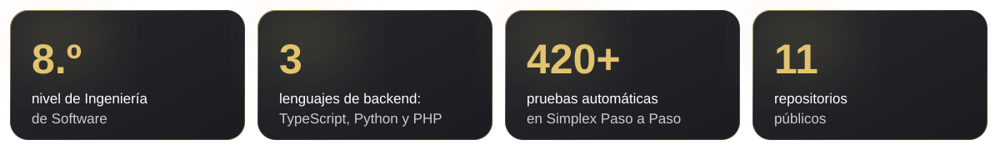
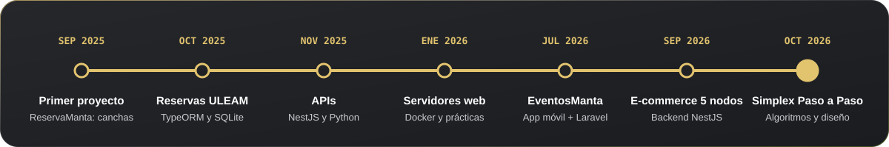
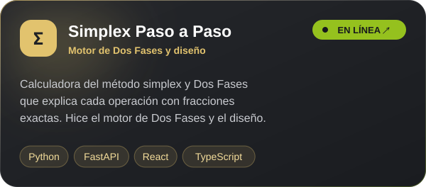
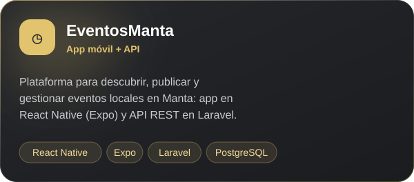
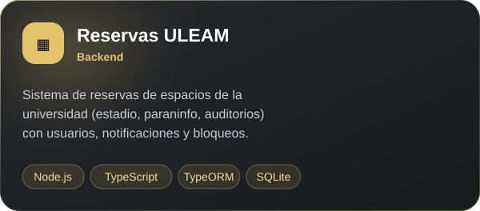
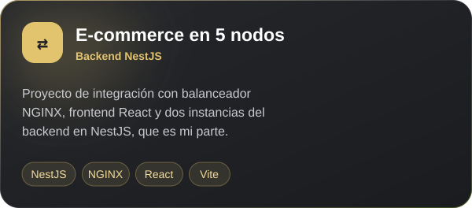
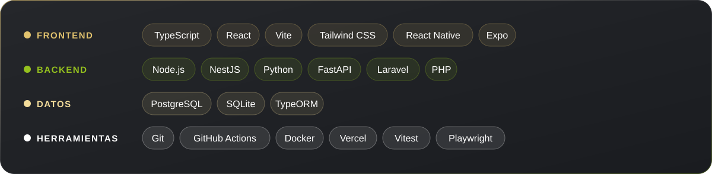

 

Soy <b>Luis Antonio Medranda Flores</b>, estudiante de octavo nivel de <b>Ingeniería de
Software</b> en la <b>Universidad Laica Eloy Alfaro de Manabí (ULEAM)</b>, en Manta, Ecuador.

Lo que más me define es que <b>trabajo bien en equipo</b>. Casi todo lo que hay en mi GitHub lo
hice con compañeros, y ahí aprendí que un buen proyecto se construye entre varios: escucho,
reparto bien las tareas, explico lo que hago para que otros puedan seguirlo y no suelto una
parte hasta que funciona para todos.

Soy <b>ordenado y constante</b>. Prefiero avanzar paso a paso, con cambios pequeños que se
puedan revisar, antes que hacerlo todo de golpe. Y <b>aprendo rápido lo que un proyecto
necesita</b>: en un año pasé de mis primeras páginas en React a APIs con NestJS y TypeORM,
servicios en Python, una API en Laravel, una app móvil en React Native y contenedores con Docker.

<b>🧭 Cómo trabajo</b>

<ul>
  <li>Entiendo el problema antes de escribir código.</li>
  <li>Commits pequeños, con mensajes claros.</li>
  <li>Pruebas y revisión antes de unir cambios.</li>
  <li>Todo documentado, para que otro pueda seguir.</li>
</ul>

<b>🛠️ En qué he trabajado</b>

<ul>
  <li><b>Apps web:</b> reservas de canchas deportivas en Manta, con React, Vite y Tailwind.</li>
  <li><b>Backends:</b> el sistema de reservas de espacios de la ULEAM (TypeORM y SQLite), APIs
  con NestJS y servicios REST en Python.</li>
  <li><b>Móvil:</b> EventosManta, una app en React Native (Expo) con su API en Laravel y
  PostgreSQL, para descubrir y publicar eventos de la ciudad.</li>
  <li><b>Arquitectura:</b> un e-commerce repartido en 5 nodos, donde hice el backend en NestJS
  que corre en dos instancias detrás de un balanceador NGINX.</li>
  <li><b>Algoritmos:</b> Simplex Paso a Paso, una calculadora que explica cada operación del
  método simplex; ahí programé el motor de Dos Fases y rediseñé la interfaz.</li>
</ul>

<a href="https://metodo-simplex-calculadora.vercel.app"><b>Prueba Simplex Paso a Paso en línea ↗</b></a>

<picture>
  <source media="(prefers-color-scheme: dark)" srcset="https://raw.githubusercontent.com/AntonioMedranda10/AntonioMedranda10/output/pacman-contribution-graph-dark.svg" />
  <source media="(prefers-color-scheme: light)" srcset="https://raw.githubusercontent.com/AntonioMedranda10/AntonioMedranda10/output/pacman-contribution-graph.svg" />
  
</picture>

  

